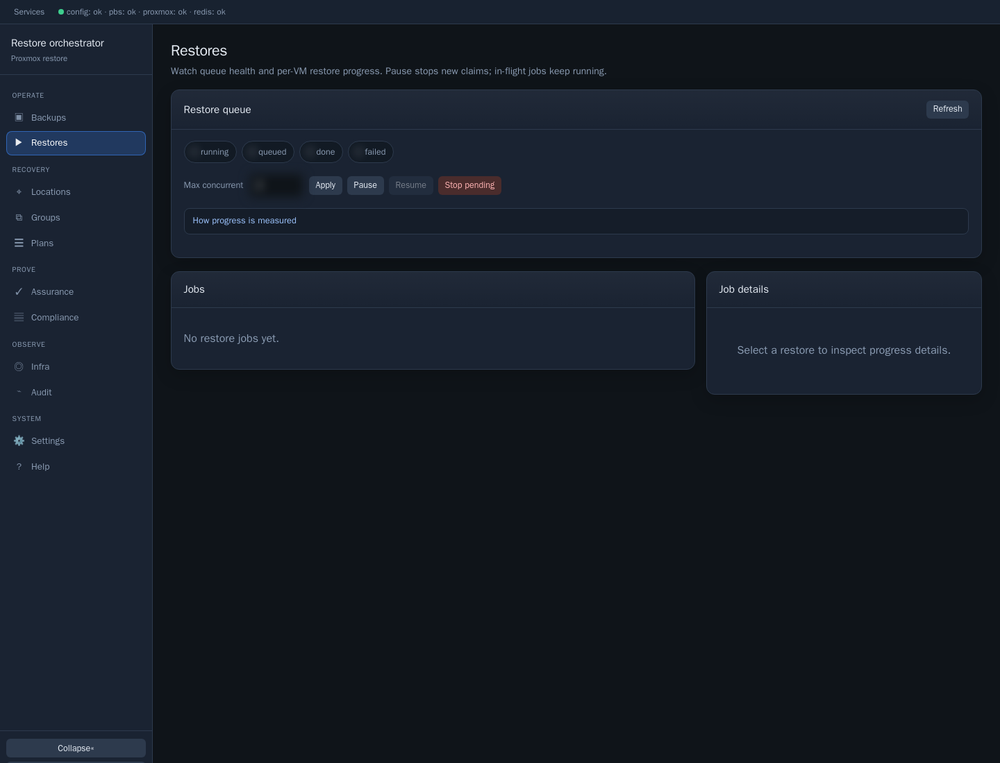
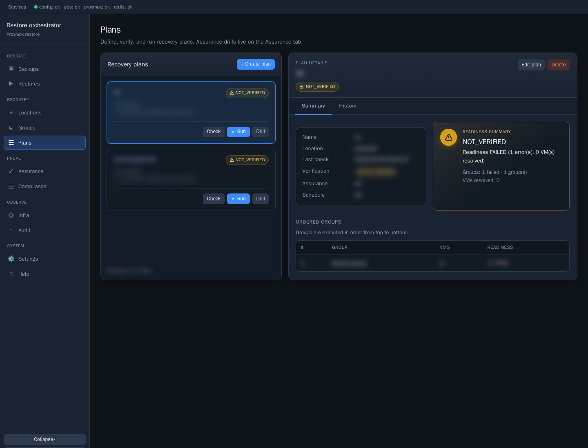
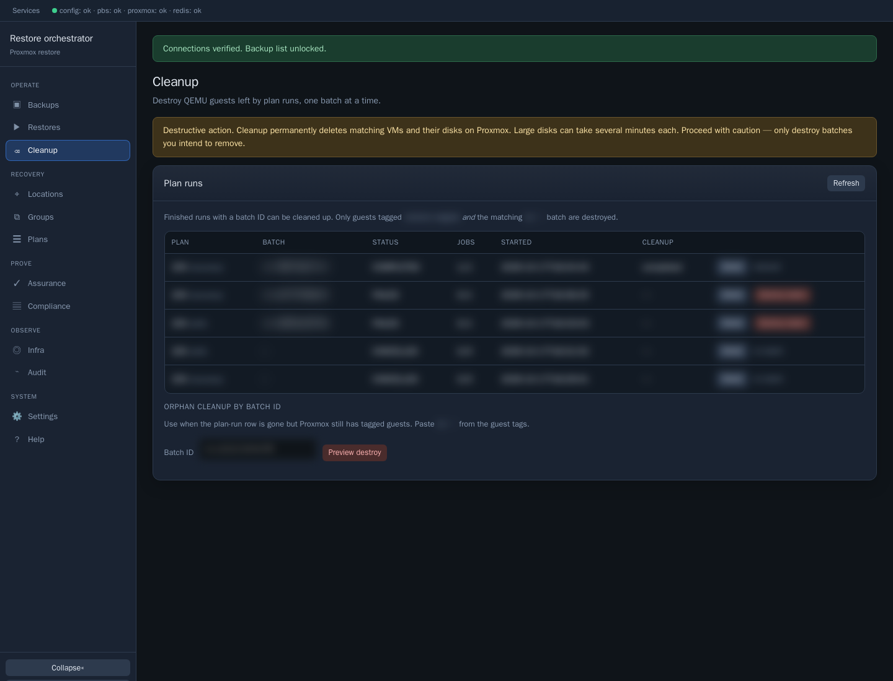
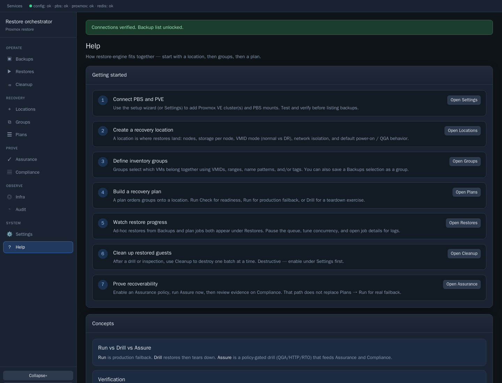

# Restore Engine

[](https://github.com/RobertLukan/restore-engine/actions/workflows/ci.yml)

Proxmox Backup Server → Proxmox VE restore orchestrator (API/UI + worker + Redis queue).

Dark dashboard for operators: multi-select backup table, bulk enqueue, recovery plans, drills, and a restores progress tab. UI patterns are similar to the separate [migration-engine](https://github.com/RobertLukan/migration-engine) project (VMware → Proxmox).

## UI

Lab screenshots with private fields blurred (names, IDs, form values). More in [`docs/screenshots/ui/`](docs/screenshots/ui/).

<p align="center">
  
  <br />
  <em>Restores — queue health, job list, and selected-job detail</em>
</p>

<p align="center">
  
  <br />
  <em>Plans — card list, readiness summary, and ordered groups</em>
</p>

<p align="center">
  
  <br />
  <em>Cleanup — opt-in batch destroy for plan-run tagged guests</em>
</p>

<p align="center">
  
  <br />
  <em>Help — Location → Group → Plan getting-started flow (includes Cleanup)</em>
</p>

## Features

- Configure **multiple PBS servers** and **multiple Proxmox VE clusters** in the UI (wizard / Settings)
- List VM backups across every server, datastore, and namespace (each row shows its source and target cluster)
- Select multiple backups at once (checkboxes + row click)
- Bulk restore with load-balanced nodes, per-node storage, VMID allocation, live restore, bandwidth limit
- **Recovery plans**: groups, locations (per-cluster), ordered runs, readiness check + VERIFIED gate, optional **add to HA** after restore, compliance reports (RTO)
- **Drills**: powered-off restore, optional auto-teardown, optional schedule (interval hours)
- **Plan batch cleanup** (opt-in): each plan run tags guests `restore-engine` + `re-<batch>`; Cleanup tab / `/api/cleanup/*` destroy only dual-tagged guests (Settings → Plan run cleanup)
- **Assurance**: policy on plans (require QGA and/or HTTP, max RTO); drill outcomes set ASSURED/FAILED; dashboard + Assure now
- **Network checks from restore-engine**: per-location opt-in for HTTP probes from the API/worker host — leave **off** for bubble / isolated labs (use QGA); enable when RE can reach guest IPs
- **Compliance**: read-only posture rollup (readiness + assurance + schedule + evidence links)
- **Audit**: browser for recent operator actions (also `GET /api/audit`)
- **Power-on + QGA** and optional **HTTP check** after guest agent is up; guest hostname vs PVE name is a warning on mismatch
- **Network isolation**: unlink NICs or remap to a lab bridge before power-on (gated unless location is isolated)
- **DR overwrite**: destroy existing VMID then restore (explicit confirm; owned guests only)
- **Email / webhook notifications** on readiness fail, plan-run terminal, optional ad-hoc job fail
- Redis-backed **concurrency slots**, job **TTL**, **audit log**, optional **API tokens** (operator/viewer)
- **Agent skills** for Cursor and [OpenClaw](https://docs.openclaw.ai/skills/) — operate the same HTTP API as the UI (`skills/restore-engine-operate`), plus domain rules and offline-bundle helpers
- **Largest-first enqueue** within each batch (ad-hoc or one plan group) so big VMs claim slots first; plan groups stay sequential
- **One plan run at a time** — starting Run / Drill / Assure while another plan is RUNNING returns HTTP 409
- Track per-job progress and logs via Redis + worker; Restores tab lists newest jobs first (Load more) and can **Clear finished**
- Ownership stamp after restore (required for reclaim/teardown); stamp failure fails the job

## Multiple PBS servers and Proxmox VE clusters

Sources are configured as a list under `pbs_servers`. Each server holds its
connection details plus one or more `mounts`, where a mount ties a
`(datastore, namespace)` to a **PVE cluster** and the **PVE storage ID** that
references that PBS on that cluster:

```yaml
pve_clusters:
  - id: default
    host: 10.0.0.20
    port: 8006
    api_token_id: root@pam!restore
    api_token_secret: SECRET
    default_node: pve
    storage: local-lvm

pbs_servers:
  - id: main
    host: 10.0.0.10
    port: 8007
    verify_ssl: false
    api_token_id: root@pam!restore
    api_token_secret: SECRET
    mounts:
      - datastore: main
        namespace: ""            # root namespace
        pve_cluster_id: default
        pve_storage: pbs-main
      - datastore: main
        namespace: team-a
        pve_cluster_id: default
        pve_storage: pbs-main-teamA
```

This mirrors how Proxmox works: **PVE binds one datastore and one namespace per
storage definition**, so each `(datastore, namespace)` you want to restore from
needs its own PVE storage entry, and that storage ID is what goes in `pve_storage`.
The backup list aggregates all sources and the restore uses the correct
`pve_storage` (and cluster) per selected backup automatically. A legacy single
`pbs:` / `proxmox:` block is still read and mapped to cluster `default`.

PBS and Proxmox VE auth: set **either** an API token (`api_token_id` +
`api_token_secret`) **or** `user` + `password`. When both are present, the token
is used.

### Plan batch tags and Cleanup

Each plan run allocates a `batch_id` (12 hex). Restored guests are tagged
`restore-engine` and `re-<batch_id>`. Teardown and the **Cleanup** tab only
destroy guests that match that dual-tag gate (or proven ownership) on the chosen
cluster. Enable Cleanup under **Settings → Plan run cleanup**
(`ui.plan_run_cleanup_enabled`); when off, `/api/cleanup/*` returns 403.
Destroy waits for PVE disk reclaim (`worker.destroy_task_timeout_sec`, `0` = unlimited).

## Restore by tags (groups)

VM tags are stored inside each backup's guest config (not in the PBS snapshot
list), so the app reads them via the PVE `vzdump/extractconfig` API (which also
works for encrypted datastores) and caches them per snapshot in Redis.

- On the **Backups** tab, click **Load tags** to populate the Tags column, then
  filter by tag and use **Select filtered** to bulk-select a group.
- **Restore by tag group** restores the newest backup per VM whose config carries
  a chosen tag, as of an optional point in time (blank = now). Internally it takes
  the latest snapshot per VMID at or before the cutoff and keeps those whose config
  includes the tag.

Because tags require one `extractconfig` call per inspected snapshot, they are
resolved on demand and cached (snapshots are immutable, so the cache is durable).

## Prerequisites

1. One or more **Proxmox Backup Servers** with API tokens that can read the datastores/namespaces you want to list.
2. **Proxmox VE** with each PBS datastore/namespace added as a storage backend; put that storage ID in the matching `mounts[].pve_storage`.
3. API token on PVE with permission to create VMs and restore from those PBS storages.

## Quick start (local)

```bash
cd restore-engine
python3 -m venv .venv
source .venv/bin/activate
pip install -r requirements.txt

# Edit config.yaml with your PBS + PVE endpoints and tokens
redis-server   # or use Docker redis only

# Terminal 1
uvicorn main:app --host 0.0.0.0 --port 8001

# Terminal 2
python worker.py
```

Open http://localhost:8001 and sign in with `ui.password` from `config.yaml`.

## Ports

| Port | Service |
|------|---------|
| **8000** | restore-engine UI (Docker Compose **host-network** default) |
| **8001** | UI when using bridge overlay or typical local `uvicorn` |
| **6380** | Redis published to the host (host-network Compose → container 6379) |
| **8006** | Proxmox VE API (`pve_clusters[].port` / legacy `proxmox.port`) |
| **8007** | Proxmox Backup Server API (`pbs_servers[].port` in config) |

Do not publish restore-engine on **8007** in public docs — that is PBS’s usual API port. See [DOCKER.md](DOCKER.md) for host vs bridge vs Mac lab networking.

## Docker Compose

Full guide (host network, Mac VPN lab, Apple Silicon → amd64, LXC, air-gap): **[DOCKER.md](DOCKER.md)**.

**Container image (GHCR):** [`ghcr.io/robertlukan/restore-engine`](https://github.com/RobertLukan/restore-engine/pkgs/container/restore-engine)

```bash
git clone https://github.com/RobertLukan/restore-engine.git
cd restore-engine
cp config.docker.example.yaml config.docker.yaml
# edit config.docker.yaml — host-network default:
#   redis.url: redis://127.0.0.1:6380/0
#   fill pve_clusters[] + pbs_servers[].mounts (pve_cluster_id / pve_storage)
docker compose pull   # or: docker compose up --build -d
docker compose up -d
```

Dashboard (host-network): http://127.0.0.1:8000  

Bridge overlay: `docker compose -f docker-compose.yml -f docker-compose.bridge.yml up -d` → UI **:8001**, `redis.url: redis://redis:6379/0`.  

Mac + VPN PBS: `./scripts/lab-mac.sh` (see DOCKER.md).

## Performance tuning

The **Settings** tab has a *Restore performance* section; the **Restores** tab mirrors concurrency live:

- **Max concurrent restores** — change anytime (including mid-batch). The worker re-reads this every second; in-flight jobs are not killed when you lower the limit.
- **Pause / Resume** — pause stops claiming new jobs and plan group enqueue; running restores finish or fail on their own. Resume continues the queue.
- **Stop pending** — pause + cancel all PENDING jobs; in-flight keeps going (use per-job Stop to abort a running restore).
- Per-job **progress % / speed / ETA** from PVE task logs (best-effort). **Speed (gross)** follows PVE progress and includes sparse/zero regions. **Est. network** scales the PBS snapshot size (sum of archive sizes) by restore progress — an approximation of wire throughput, not a measured NIC counter.
- Backup list shows **Size (gross)** from PBS; use **Estimate sizes** for an on-demand **non-zero** logical estimate from `.fidx` (better proxy for restore effort — zeros are fast). See [docs/dr-overview.md](docs/dr-overview.md).
- **Default bandwidth limit** and **Live restore by default** in Settings pre-fill restore dialogs.

Per restore batch, the **Restore selected** dialog also lets you set a **bandwidth limit** (passed to Proxmox as `bwlimit`), toggle **live restore**, and **multi-select Proxmox nodes** with a **storage dropdown per node**. Jobs load-balance across nodes; VMIDs are cluster-wide unique.

Note: Proxmox-side throttles (a `bwlimit` in `datacenter.cfg` or on the storage, and PBS Traffic Control rules) apply on top of these and are the most common cause of slow restores.

## Workflow

1. **Settings / wizard** — add one or more **PVE clusters** and PBS mounts (`pve_cluster_id` + `pve_storage`); verify connections. Optional SMTP/webhook, API tokens, and **Plan run cleanup**.
2. **Groups / Locations / Plans** — inventory groups, a recovery location (cluster, isolation, optional HTTP URL + **network checks from restore-engine**), and a plan (`add_to_ha` optional); schedule for automatic drills if needed.
3. **Check** a plan (readiness), then **Run** or **Drill** with point-in-time; note the run’s `batch_id`; download reports from the Plans tab.
4. **Assurance** — set policy (QGA and/or HTTP), **Assure now**, watch ASSURED/FAILED (does not perform production failback). For bubbles, prefer Require QGA and leave location network checks **off**.
5. **Cleanup** (if enabled) — preview/destroy batch-tagged drill guests after a run, or use plan-run teardown.
6. **Compliance** — read-only posture across plans (readiness, assurance, schedule, report links).
7. **Backups** — refresh list, optionally **Estimate sizes** (non-zero), select backups, **Restore selected** (ad-hoc) with isolation / overwrite / HA options.
8. **Restores** — watch job state and progress; stop queued jobs if needed.
9. **Infra** — Grafana embed (optional) and/or live PVE/PBS CPU/RAM snapshot.
10. **Audit** — browse recent operator actions when investigating who changed what.

DR workflow and safety defaults: **[docs/dr-overview.md](docs/dr-overview.md)** (generic). Site-specific topology belongs in your internal runbooks.

Infrastructure metrics (Grafana, Netdata, PVE/PBS OpenTelemetry): **[docs/infra-metrics.md](docs/infra-metrics.md)**.

## Production checklist

Lab defaults favor convenience. For anything beyond a closed lab:

1. **TLS** — put a reverse proxy (Caddy/nginx) in front of the UI port (`:8000` host-net or `:8001` bridge) with HTTPS and secure cookies; do not expose plain HTTP on a shared network.
2. **`ui.session_secret` (required) / `ui.password`** — strong unique values; the API **refuses to start** if `ui.session_secret` is missing, shorter than 32 characters, or the dev placeholder (including token-only deployments).
3. **`worker.require_verified_to_run: true`** (or `plans.require_verified_to_run`) — block production Runs until readiness is VERIFIED (drills/Assure can still use `allow_unverified` where intended).
4. **Secrets** — keep `config.docker.yaml` out of git; prefer API tokens over passwords; treat SMTP password and PBS/PVE tokens as sensitive.
5. **Redis** — prefer localhost-only publish (`127.0.0.1:6380`) or internal Docker network; do not expose Redis on a shared LAN in production.
6. **Single worker (or documented scale)** — concurrency slots are Redis-backed; still prefer one worker replica unless you understand shared-queue behavior (`DOCKER.md`).
7. **Isolation** — power-on / QGA only with unlink/remap or an isolated location; avoid `allow_non_isolated` on shared L2. Keep **network checks from restore-engine** off unless RE truly reaches guest IPs.
8. **Cleanup** — leave `plan_run_cleanup_enabled` false until operators need the Cleanup tab; destroy is permanent.
9. **Notifications** — enable SMTP or webhook so failed readiness/drills are not UI-only.

See also **Safety notes** below and **[DOCKER.md](DOCKER.md)**.

## Safety notes (power-on and verify)

Power-on and QGA require **network isolation** (`unlink` / `remap`), an **isolated** location flag, or an explicit **allow non-isolated** override. **Live restore** boots before NIC changes can run — it needs an already-**isolated** location or `allow_non_isolated` (post-restore unlink/remap alone is not enough). On a shared production L2, prefer powered-off drills.

**HTTP checks from the orchestrator** need L3 from restore-engine to the guest URL. On bubble / remapped lab networks that path often does not exist — disable **Network checks from restore-engine** on the location and use **Require QGA** (works for Windows and Linux via the PVE guest agent). East-west “same VLAN” probes are a later optional design; they are not required for QGA-local assurance.

## API tokens

In `config.yaml` / `config.docker.yaml`:

```yaml
ui:
  password: "..."
  session_secret: "..."
  api_tokens:
    - name: automation
      token: "long-random-secret"
      role: operator   # or viewer (GET only)
```

Send `Authorization: Bearer <token>` instead of a session cookie. Operator actions are recorded in the Redis audit log (`GET /api/audit` and the **Audit** tab).

Use a dedicated operator token when driving restore-engine from **OpenClaw** or other agents (see **Agent skills / OpenClaw** below). Never put the token in chat logs or git.

## Agent skills / OpenClaw

restore-engine ships Agent Skills under [`skills/`](skills/) (symlinked for Cursor as `.cursor/skills/` and `.agents/skills/`). They work with **Cursor Agent Skills** and **[OpenClaw](https://docs.openclaw.ai/skills/)** so an agent can drive the same `/api/*` endpoints as the web UI — without talking to PBS/PVE directly.

| Skill | Purpose |
| --- | --- |
| [`restore-engine-operate`](skills/restore-engine-operate/SKILL.md) | HTTP workflows: backups, restores, plans, cleanup, jobs (Bearer token) |
| [`restore-engine-domain`](skills/restore-engine-domain/SKILL.md) | Product invariants (enqueue order, plan lock, batch tags, multi-PVE, safety) |
| [`restore-engine-offline-bundle`](skills/restore-engine-offline-bundle/SKILL.md) | Air-gap Docker bundle build/deploy |

**OpenClaw quick start**

1. Add an `ui.api_tokens` entry with `role: operator` (see above).
2. On the OpenClaw host, set:
   - `RESTORE_ENGINE_URL` — e.g. `http://127.0.0.1:8000` (host-network) or `http://localhost:8001` (bridge)
   - `RESTORE_ENGINE_TOKEN` — the operator token
3. Install the skills from a checkout of this repo, for example:
   ```bash
   openclaw skills install ./skills/restore-engine-operate
   openclaw skills install ./skills/restore-engine-domain
   openclaw skills install ./skills/restore-engine-offline-bundle
   ```
   Cursor users can rely on the `.cursor/skills` / `.agents/skills` symlinks in the workspace.
4. Prefer the helper in the operate skill: `skills/restore-engine-operate/scripts/re-api.sh`.

Confirm destructive actions (DR overwrite, cleanup destroy, bulk restore) with a human before the agent calls mutating APIs. Domain skill documents the safety defaults. OpenClaw skill authoring: [docs.openclaw.ai/tools/creating-skills](https://docs.openclaw.ai/tools/creating-skills).

## Notifications

Under `notifications:` configure SMTP and/or a webhook URL. Events (opt-in): readiness check failed, plan/drill finished, optional ad-hoc job failed. Send is best-effort and never fails a restore. Settings UI can send a test email.

## Archive path

Restores use the PVE PBS storage reference of the backup's own source:

`{mount.pve_storage}:backup/vm/{vmid}/{timestamp}`

Example: `pbs-main:backup/vm/100/2026-05-01T01:00:00Z`

Each PBS snapshot is identified by `vm/{vmid}/{timestamp}` (the backup time is
included so a specific snapshot is restored, and multiple snapshots of the same
VM are selectable independently).

## PCI passthrough and API user privileges

Guest tags and most restores work with a normal Proxmox API user (for example
`flaskapp@pve`). Backups that include **PCI passthrough** (`hostpci*`) are
different: Proxmox only allows **root** to set `hostpci` config for non-mapped
devices. Restoring such a backup with a non-root token/user fails with:

```text
only root can set 'hostpci0' config for non-mapped devices
```

Options:

- Restore with `root@pam` (password or API token) when the backup has passthrough, or
- Remove / avoid `hostpci*` on the source VM before backup (or use mapped PCI
  devices that non-root may manage), or
- Use a drill/clone without passthrough for recovery tests.

The worker surfaces that Proxmox message on the failed job; it is not a PBS or
tag-matching problem.

## Development & tests

```bash
cd restore-engine
python3 -m venv .venv
source .venv/bin/activate
pip install -r requirements-dev.txt
pytest
# optional coverage:
pytest --cov=. --cov-report=term-missing --cov-fail-under=0
```

The suite is **offline** (FakeRedis + mocks) against `tests/fixtures/minimal_config.yaml` — no live PBS, Proxmox VE, or Redis required. It covers VMID allocation, archive volids, PBS parsing, auth, health/version, plans/jobs domain logic, worker `process_job` (mocked), hygiene/audit, and selected HTTP routes.

**Feature vs test gaps:** see **[docs/gap-analysis.md](docs/gap-analysis.md)**.

**Safety/security code review (2026-11-14):** see **[findings, reproduction evidence, and recommended fixes](docs/code-review-2026-11-14.md)**. The review records five high-priority issues and one medium-priority API defect; fixes are not included in the report.

Contributing and security: **[CONTRIBUTING.md](CONTRIBUTING.md)**, **[SECURITY.md](SECURITY.md)**.

---

## 🧩 The Proxmox Enterprise Lifecycle Suite

This repository is part of an open-source automation suite engineered to bring enterprise orchestration, zero-drama cutovers, and verifiable disaster recovery to **Proxmox VE** and **Proxmox Backup Server**:

| Lifecycle Phase | Project | Description |
| :--- | :--- | :--- |
| **1. Migrate (Day 0)** | [**migration-engine**](https://github.com/RobertLukan/migration-engine) | VMware ESXi → Proxmox VE mass migration orchestrator (FastAPI + Redis worker queue, direct SCSI boot import, QGA & WinRM automation). |
| **2. Provision (Day 1)** | [**proxmox-guestos-customization**](https://github.com/RobertLukan/proxmox-guestos-customization) | VMware-style Windows template cloning, QGA-driven Sysprep, static/DHCP networking, AD domain join, and bulk VDI rollout sidecar. |
| **3. Recover & Assure (Day 2)** | [**restore-engine**](https://github.com/RobertLukan/restore-engine) | Multi-cluster PBS → PVE disaster recovery orchestrator, automated isolated DR drills, QGA/HTTP assurance gates, and RTO compliance reporting. |
| **4. Foundation (IaC)** | *PVE Infrastructure-as-Code (WIP)* | Declarative cluster state, SDN, Ceph/storage, and zero-drift configuration management *(Public preview coming soon)*. |

### 🏢 Enterprise Architecture & Commercial Support
Maintained by **Robert Lukan** — Founder & Principal Architect at **Stackvolve Systems Ltd**.  
Planning a large-scale transition off VMware or legacy HCI toward open-source European digital sovereignty? We help organizations design, automate, and execute production Proxmox VE & Ceph migrations and NIS2-compliant DR architectures.  
👉 Connect via [**LinkedIn**](https://www.linkedin.com/in/robertlukan/) or reach out through [**Stackvolve Systems**](https://github.com/RobertLukan).
